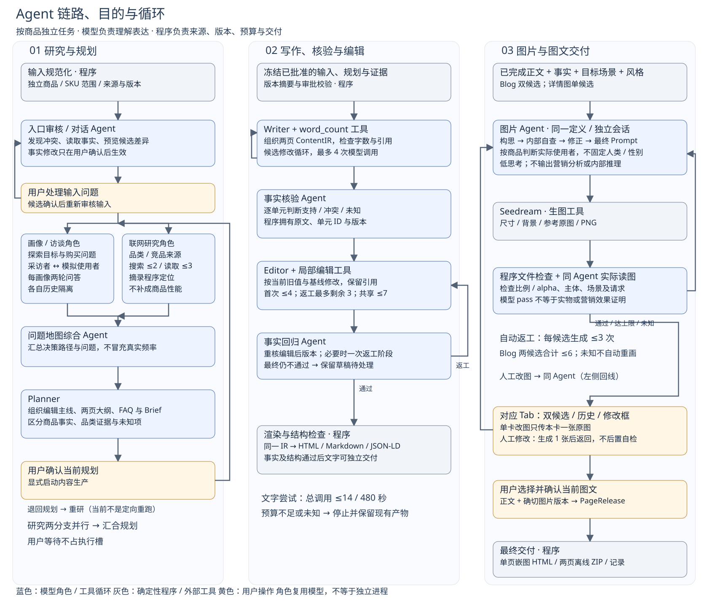
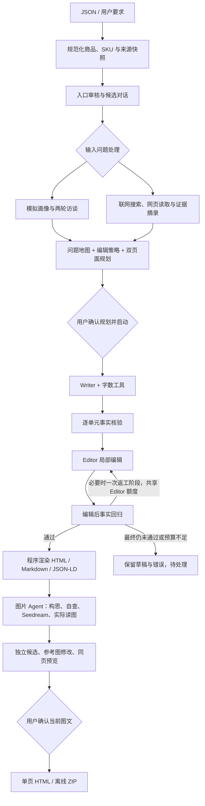
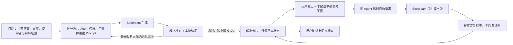

# GEO Content Weave

一个本地运行的商品研究与图文生产工作台：从商品 JSON 和任务要求出发，组织模拟受众研究、联网证据检索、双页面规划、事实核验、编辑及图片生成，交付 Blog 和商品详情页。

项目关注的核心问题是：**让模型负责理解、研究与表达，让程序负责事实来源、版本、预算和交付的一致性。** 每个商品是独立任务；SKU 保留为变体，不拆成重复文章。

## 能做什么

- 导入单个或多个 JSON，按品牌／商品管理任务；某项等待确认不阻塞其他可执行任务。
- 发现指令与商品资料冲突，通过对话形成候选方案，展示差异后由用户确认。
- 模拟购买者的两轮访谈，结合联网品类／竞品研究，生成 Blog 与详情页规划。
- 写作、逐单元事实核验、局部编辑与事实回归，输出 HTML、Blog Markdown、Product JSON-LD。
- Blog 提供“实际使用者入镜”和“仅商品与场景”两种图片候选；使用者按商品判断，不固定为人或某种性别。详情图支持真实透明背景及已确认颜色的错位展示。
- 分别修改图片、保留版本、在对应 Tab 一次确认图文，下载单页 HTML 或包含图片与生成记录的离线 ZIP。

这是本地单用户工具。模拟画像不是实际用户调研；结构检查不等于搜索平台收录资格；图片是带标记的 AI 视觉示意。

## 快速启动

需要 Python **3.11+**（当前在 Windows / Python 3.12 验证）。文本与研究需要 DeepSeek API Key；图片功能另需 Seedream API Key。Node.js 仅用于前端契约测试，运行工作台不需要 Node。

### Windows · PowerShell

在项目根目录执行：

```powershell
py -3.12 -m venv .venv
.\.venv\Scripts\python.exe -m pip install -r requirements.txt
if (-not (Test-Path .env)) { Copy-Item .env.example .env }
notepad .env
```

填入 API Key 并保存，然后启动：

```powershell
.\.venv\Scripts\python.exe -m geo_workbench --open
```

安装完成后也可双击 `start.cmd`。不需要激活虚拟环境或修改 PowerShell 执行策略。

### macOS · Terminal

确认 `python3 --version` 为 3.11 或更高，然后在项目根目录执行：

```sh
python3 -m venv .venv
.venv/bin/python -m pip install -r requirements.txt
[ -f .env ] || cp .env.example .env
open -e .env
```

填入 API Key 并保存，然后启动：

```sh
.venv/bin/python -m geo_workbench --open
```

需要双击启动时先执行 `chmod +x start.command`，再打开该文件。macOS 命令和字体路径已适配，当前没有 macOS 真机测试结果。

默认地址为 **http://127.0.0.1:8765/**，Ctrl+C 停止。端口被占用时使用 `--port 8877`。已有验收数据可通过 `.env` 的 `GEO_DATA_DIR` 指向原目录；默认启动不会自动选择其他数据目录。

`.env.example` 只保留空凭证与配置说明。真实 `.env`、数据库、生成图片和开发归档均被排除在发布范围外。

## 使用流程

1. 导入 [LUMA 示例](test-data/luma-normal.json) 或自己的商品 JSON，填写主题和输出要求。
2. 如有输入冲突，选择按原资料继续，或审阅并确认事实／任务候选。历史商品不会自动补入本次输入。
3. 查看受众问题、来源、编辑策略和双页面规划，确认当前规划。
4. 显式启动内容生成。必要事实与结构检查通过后即可下载文字结果；失败保留已有产物和错误位置。
5. 在 Blog／详情页 Tab 生成图片。Blog 两候选可独立改图，每次修改只引用本卡所选的一张原图。
6. 确认喜欢的图文版本后下载该页 HTML；两页都确认后下载 ZIP，解压即可离线查看页面及相互链接。

## 核心技术流程



图中的蓝色是模型角色、灰色是程序／外部工具、黄色是用户操作。可独立打开 [SVG 图](docs/agent-workflow.svg)，在支持 SVG 的画板编辑；布局与文字源在 [绘图脚本](scripts/render_agent_map.py)。下方 Mermaid 是可直接修改文本、由 GitHub 渲染的流程版本。



图片的自动和人工循环不同，不能把人工意见送入自动自检循环：



研究与内容流程使用 LangGraph；图片流程复用同一持久队列，用受控循环管理生成和返工。多个角色复用 DeepSeek，并不是每个角色启动一个独立进程。Seedream 是图片 Agent 的生成工具。

| Agent / 角色 | 原理与职责 | 关键约束 |
|---|---|---|
| 入口审核与对话 | 比较当前事实和用户要求；调用读取事实、预览候选工具 | 模型不能直接改事实；差异必须由用户确认 |
| 画像选择 | 按主题与场景选择最多四个模拟画像 | 不把模拟问题数量解释成真实需求比例 |
| 采访者与模拟使用者 | 每画像两轮独立对话，第二轮承接首轮并加入商品事实 | 画像之间历史隔离；中断保留未完成状态 |
| 问题地图综合 | 将访谈整理为决策路径、购买问题与优先级 | 问题来自本次访谈，不伪造市场搜索量 |
| 联网研究 | 规划查询，程序搜索和读取，模型提取证据摘录 | URL 去重和域名分散；摘录由程序核对原文 |
| Planner | 汇合画像、证据和任务，形成编辑主线、双页大纲与写作 Brief | 区分品类建议与商品事实；规划先确认再写作 |
| Writer | 生成结构化 ContentIR，利用字数工具检查候选 | 两页按不同阅读目标组织，不直接生成不受控 HTML |
| 事实核验 | 对程序分配的正文单元判断支持、冲突或未知，编辑后再回归 | 单元 ID／版本由程序控制，避免模型转述导致定位错误 |
| Editor | 基于核验结果提出局部编辑，工具检查目标、旧值与版本 | 不任意覆盖全文；保留下游核验预算 |
| 图片 Agent | 从主题、目标场景和事实构思，同调用内自查；调用 Seedream，再实际读图 | 一个定义、多份隔离会话；人工改图只生成一版，不后置自检 |

详细输入、输出、工具、修复边界见 [Agent 说明](docs/agents.md)。

## 难点与解决思路

**证据有链接，不代表支持商品主张。** 系统区分商家事实、品类知识、竞品信息、普通建议和缺失披露。外部网页不能自动补成商品的认证、性能或售后承诺；缺失披露必须核对当前输入路径。

**核验模型也会写错引用位置。** 正文先由程序拆成稳定单元。核验 Agent 返回单元 ID 和判断，程序从对应版本取原文；未知、重复、缺失或旧版本 ID 被拒绝。协议错误优先在核验输出层修复，不直接当成正文事实错误交给 Editor。

**编辑容易越改越偏或耗尽预算。** Writer／Editor 使用候选工具，检查字数、原值、引用和版本；修改后重新做事实回归。角色预算和总预算同时限制，并为后续核验预留调用。

**图片相关却不适合作为首图。** Blog Skill 同时关注标题、全文、目标使用场景和商品关联，先构思、自查、修正，再输出可渲染的六字段 Prompt。字段是应用内部结构，最终串成 Seedream 的文本 `prompt`。详情图使用另一套展示结构，两页共享视觉风格输入。

**多候选容易串历史或抢走选图。** Blog 的使用者入镜／无使用者候选各有会话、草稿、原图、预算和谱系；页面选择独立保存。另一候选返回不会覆盖用户当前选图。确认绑定正文和具体图片版本，历史批准不自动迁移。

**外部超时无法判断是否已经计费。** 请求先持久化，未知结果和执行中断不自动重放；图片即使读图失败也保留原始产物。重试由用户显式触发。

## 技术栈与依赖

| 层次 | 实现 |
|---|---|
| 后端与本地 API | Python、FastAPI、Uvicorn、Pydantic |
| 工作流与模型 | LangGraph、SQLite checkpointer、LangChain DeepSeek、DeepSeek Flash |
| 联网研究 | DeepSeek 搜索／网页读取 API、HTTPX |
| 图片 | Seedream 5.5、DeepSeek 视觉输入、Pillow PNG／alpha 检查和标记 |
| 持久化 | SQLite 事务队列、不可变文件产物、事件与版本记录 |
| Web | 原生 HTML / CSS / JavaScript，无前端构建步骤 |
| 测试 | unittest、FastAPI TestClient、Node.js VM 交互契约 |

直接依赖的固定版本见 [requirements.txt](requirements.txt)。这是直接依赖清单，不是完整传递依赖锁文件。

## 联网与运行边界

所有模型 API 和工具请求按正常本地程序访问外网，不依赖 Codex 的沙箱授权。HTTP 客户端继承环境代理；需要代理时在 `.env` 配置 `HTTPS_PROXY`／`HTTP_PROXY`，用 `NO_PROXY=127.0.0.1,localhost` 保留本地访问。

联网职责保持不变：研究阶段搜索和读取网页；Writer、核验、Editor 使用冻结的事实与证据；图片 Agent 访问模型和生图 API，不自行新增网页证据。网络访问正常不代表账号额度、认证或供应商服务一定可用。

每次研究最多 2 次搜索、3 次网页读取。一次文字尝试最多 14 次模型调用、480 秒、已观测 240000 tokens；Writer 最多 4 次，Editor 首次与返工共享最多 7 次。Blog 每候选最多 3 次自动生成，两候选合计最多 6 次；详情图单候选最多 3 次。人工图片修改每次显式提交生成一张。

Web 只监听本机、单进程运行，保留同源和本地写入令牌保护。此入站访问边界不限制后端访问外网。不要使用 `--reload` 或多个 worker 运行有活跃任务的数据目录。

更多配置、数据恢复和网络排查见 [运行说明](docs/operations.md)。

## 目录与验证

```text
geo_workbench/       后端、工作流、应用 Skills 与静态 Web
docs/               当前需求、架构、Agent 与运行说明
test-data/          正常、诱导、缺失与跨品类输入
examples/           原始示例商品 JSON
tests/              后端回归与前端交互契约
scripts/            发布检查与纯源码打包
.env.example        不含凭证的配置示例
```

Windows：

```powershell
.\.venv\Scripts\python.exe -m unittest discover -s tests
node tests/test_stage_c_drafts.cjs
node tests/check_images_ui.cjs
.\.venv\Scripts\python.exe scripts/prepare_release.py --check
```

macOS 将 Python 命令替换为 `.venv/bin/python`。自动测试使用隔离目录和替身，不调用收费 API；真实模型结果与人工体验另行判断，不能用测试数量保证内容或图片永不出错。

发布源码前可运行 `python scripts/prepare_release.py`，生成仅含发布清单的 `.release/geo-aigc-source.zip`。脚本检查本地真实凭证是否混入源码，并验证当前文档链接；`.env` 不进入 ZIP。提交前检查 `git status` 和暂存区，勿使用 `git add -f .env`。

代码贡献方式与默认分支规则见 [贡献说明](CONTRIBUTING.md)。项目保留仓库已有的 [许可证](LICENSE)。

当前功能与验证边界见 [文档索引](docs/README.md)。旧版阶段日志、临时探针、生成结果保留于本地归档，默认不发布。
